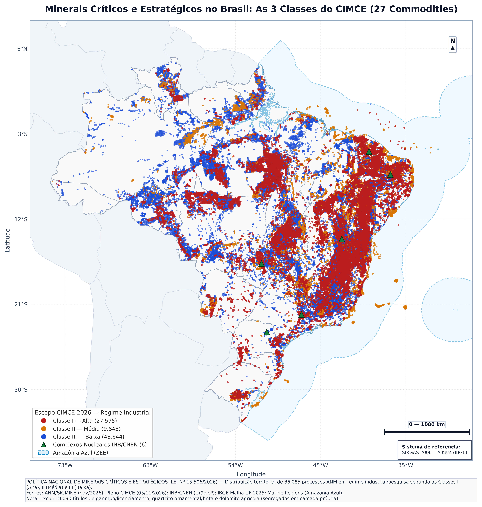
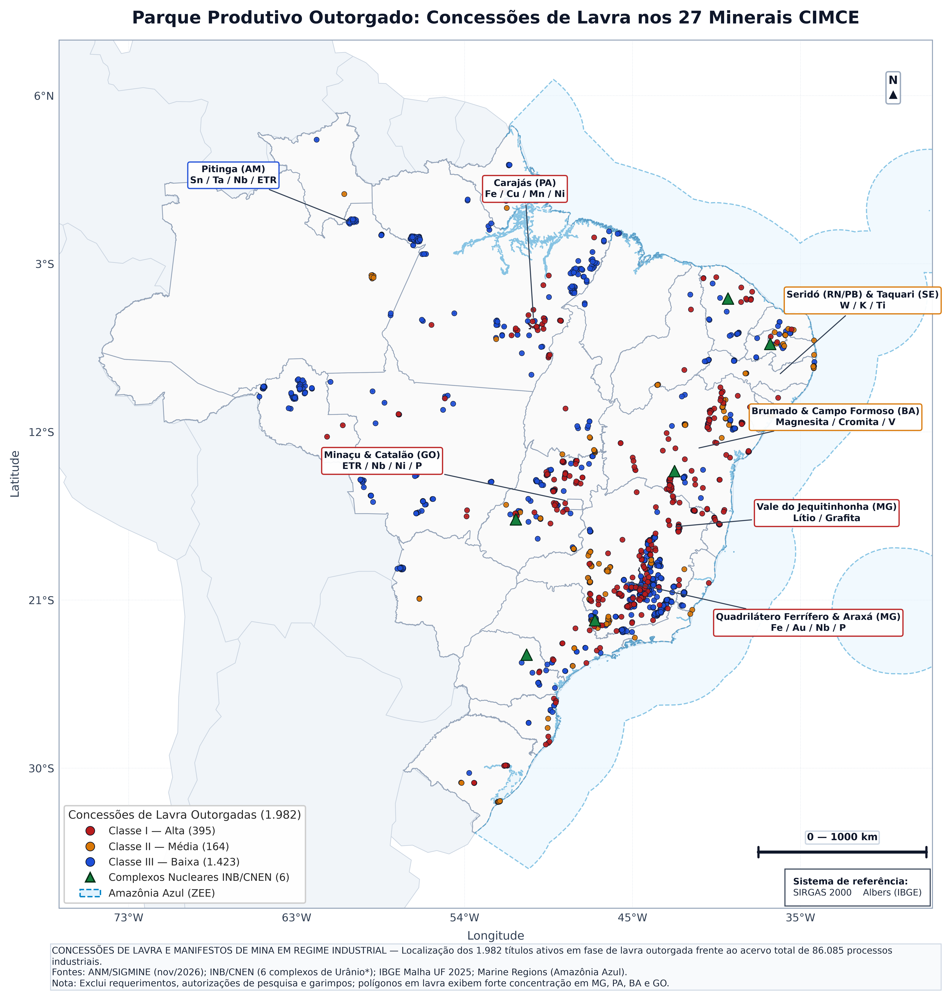

# Minerais Críticos e Estratégicos do Brasil (`mince_brasil`)

[](pyproject.toml)
[](output/figures/png/)
[-1D4ED8.svg)](data/curated/cimce_2026_ontology.json)
[](LICENSE)
[](output/LICENSE)

Mapeamento dos **27 minerais críticos e estratégicos** definidos pela Política Nacional de Minerais Críticos e Estratégicos (PNMCE — Lei nº 15.506/2026, Decretos nº 13.118 e nº 13.146/2026 e Pleno do CIMCE de 05/11/2026), gerado a partir de dados públicos da ANM/SIGMINE e do IBGE em projeção equivalente Albers (SIRGAS 2000).

> [!NOTE]
> Este repositório (`mince_brasil`, pasta local `minerais_criticos_brasil`) reúne um **excerto cartográfico (snapshot nov/2026)** com **5 mapas nacionais a 600 DPI** (`fig_01` a `fig_05`), a lista estruturada dos 27 minerais em 3 classes ([`cimce_2026_ontology.json`](data/curated/cimce_2026_ontology.json)) e o código para baixar as bases oficiais via `src/fetch_sources.py` e reproduzir as figuras. Dados brutos pesados não são versionados no Git.

---

## Mapas Publicados (`600 DPI`, CC BY 4.0)

| Prancha | Descrição | Arquivo |
| :---: | :--- | :--- |
| **Fig. 01** | **Mapa Nacional — As 3 Classes de Prioridade do CIMCE (27 Minerais):** distribuição territorial dos títulos industriais/de pesquisa nas Classes I (Alta), II (Média) e III (Baixa), Amazônia Azul e 6 complexos nucleares INB/CNEN. | [`fig_01_mapa_nacional_3_classes_cimce_600dpi.png`](output/figures/png/fig_01_mapa_nacional_3_classes_cimce_600dpi.png) |
| **Fig. 02** | **Mapa Nacional — Concessões de Lavra Outorgadas:** parque produtivo em regime industrial (`Concessão de Lavra` / `Manifesto de Mina`), com polos produtores destacados. | [`fig_02_mapa_concessoes_lavra_grande_porte_600dpi.png`](output/figures/png/fig_02_mapa_concessoes_lavra_grande_porte_600dpi.png) |
| **Fig. 03** | **Classe I — Prioridade Alta (9 minerais):** Terras Raras, Grafita, Lítio, Níquel, Cobalto, Cobre, Manganês, Silício (industrial) e Urânio\* (ANM + 6 complexos INB). | [`fig_03_mapa_classe1_prioridade_alta_600dpi.png`](output/figures/png/fig_03_mapa_classe1_prioridade_alta_600dpi.png) |
| **Fig. 04** | **Classe II — Prioridade Média (8 minerais):** Tungstênio, Cromo, Vanádio, Tântalo, Titânio, Fosfato, Potássio e Enxofre. | [`fig_04_mapa_classe2_prioridade_media_600dpi.png`](output/figures/png/fig_04_mapa_classe2_prioridade_media_600dpi.png) |
| **Fig. 05** | **Classe III — Prioridade Baixa (10 minerais):** Nióbio, Estanho, Ferro, Zinco, Ouro (industrial), Magnésio, Molibdênio, Tório\* (monopólio federal), Alumínio e Grupo da Platina. | [`fig_05_mapa_classe3_prioridade_baixa_600dpi.png`](output/figures/png/fig_05_mapa_classe3_prioridade_baixa_600dpi.png) |

<p align="center">
  
  
</p>

*(Ver também o recorte temático específico para Terras Raras em [`jonathanobr/terras_raras_brasil`](https://github.com/jonathanobr/terras_raras_brasil).)*

---

## Rigor Ontológico e Escopo Metodológico

- **27 Minerais em 3 Classes ([`cimce_2026_ontology.json`](data/curated/cimce_2026_ontology.json)):** `9` na Classe I (Alta), `8` na Classe II (Média) e `10` na Classe III (Baixa).
- **Segregação de Regimes na ANM/SIGMINE:** o ETL (`src/etl_cimce_anm.py`) separa estritamente processos de **Regime Industrial / Pesquisa** de títulos em `LAVRA GARIMPEIRA`, `LICENCIAMENTO` e `REGISTRO DE EXTRAÇÃO` (especialmente expressivos em Ouro e Estanho).
- **Higiene de Substâncias e `USO`:**
  - **Silício:** aceita `QUARTZO` e `QUARTZITO` **somente** quando `USO` pertence a `{INDUSTRIAL, METALURGIA, FABRICACAO DE LIGAS}`, expurgando milhares de processos ornamentais/brita.
  - **Magnésio:** exclui `DOLOMITO`, `CALCARIO DOLOMITICO`, `MARMORE DOLOMITICO` e `CALCARIO MAGNESIANO`.
  - **Bloqueio de Falsos Positivos:** barra `CITRINO` (capturado em buscas abertas por `ITRI`), `OURO PIGMENTO` e `TITANITA`.
  - **Monopólio Federal (`Urânio*` e `Tório*`):** complementa com os 6 complexos nucleares INB/CNEN (CF arts. 21 e 177).
- **Nota sobre Snapshots Dinâmicos:** as 5 imagens PNG incluídas neste repositório correspondem ao snapshot oficial da ANM/SIGMINE de **nov/2026** (`270.994` processos totais; `86.085` industriais e `19.090` de garimpo/licenciamento). Como a ANM atualiza `BRASIL.zip` continuamente, novas execuções com `--fetch` refletirão o corte vigente na data do download. Os rodapés das pranchas congeladas preservam referências editoriais ao conjunto completo de análises de origem.

---

## Estrutura do Repositório

```text
.
├── .github/workflows/ci.yml           # Integração contínua (pytest)
├── data/
│   └── curated/
│       └── cimce_2026_ontology.json   # Taxonomia canônica dos 27 minerais e regras de filtro ANM
├── output/
│   ├── LICENSE                        # Licença CC BY 4.0 para os mapas prontos
│   └── figures/png/                   # Figuras 01 a 05 (600 DPI)
├── src/
│   ├── config.py                      # CRS IBGE Albers, paletas, formatação PT-BR e resolvedores
│   ├── fetch_sources.py               # Download oficial (ANM/SIGMINE, IBGE UF 2025, VLIZ EEZ, Natural Earth)
│   ├── etl_cimce_anm.py               # Classificação ontológica, higiene de regime e reprojeção
│   ├── build_figures.py               # Renderização cartográfica 600 DPI
│   └── run_all.py                     # Orquestrador CLI
├── tests/
│   └── test_cimce_integrity.py        # Testes automatizados (ontologia, filtros ANM, figuras e metadados)
├── CITATION.cff                       # Metadados de citação acadêmica
├── LICENSE                            # Licença MIT para o código-fonte
├── NOTICE.md                          # Créditos e termos das fontes públicas
├── pyproject.toml                     # Empacotamento e dependências Python
└── requirements.txt                   # Lista de dependências para pip
```

---

## Instalação e Reprodução

```bash
git clone https://github.com/jonathanobr/mince_brasil.git
cd mince_brasil

python -m venv .venv
# Linux/macOS: source .venv/bin/activate
# Windows PowerShell: .venv\Scripts\Activate.ps1

pip install -r requirements.txt
```

### Baixar fontes oficiais e regenerar os mapas (Figuras 1–5)

```bash
# Pipeline completo: baixa ANM/SIGMINE + IBGE UF 2025 + VLIZ Amazônia Azul + Natural Earth,
# executa ETL ontológico e gera os mapas PNG a 600 DPI:
python src/run_all.py --fetch --png-only

# Ou passo a passo:
python src/fetch_sources.py
python src/etl_cimce_anm.py --skip-socioenv
python src/build_figures.py --figures 1 2 3 4 5 --png-only

# Executar suíte de testes:
pytest -v
```

---

## Licenciamento e Citação

- **Código-fonte (`src/`, `tests/`):** licenciado sob a **[Licença MIT](LICENSE)**.
- **Mapas prontos (`output/figures/png/`):** licenciados sob **[Creative Commons Attribution 4.0 International (CC BY 4.0)](output/LICENSE)**.
- **Fontes primárias de terceiros:** nenhum direito autoral é reivindicado sobre os dados públicos da ANM/SIGMINE, IBGE, Marine Regions/VLIZ (CC BY 4.0), Natural Earth (Domínio Público), INB/CNEN ou atos normativos oficiais (Lei nº 9.610/1998, art. 8º, IV). Consulte [`NOTICE.md`](NOTICE.md) e [`CITATION.cff`](CITATION.cff).

```bibtex
@software{RamosOliveira2026MinceBrasil,
  author  = {Ramos Oliveira, Jonathan},
  title   = {mince\_brasil: Mapas dos 27 Minerais Críticos e Estratégicos do Brasil (excerto cartográfico — snapshot nov/2026)},
  version = {1.0.0},
  year    = {2026},
  url     = {https://github.com/jonathanobr/mince_brasil},
  note    = {Código sob licença MIT; mapas em output/figures/ sob CC BY 4.0}
}
```
